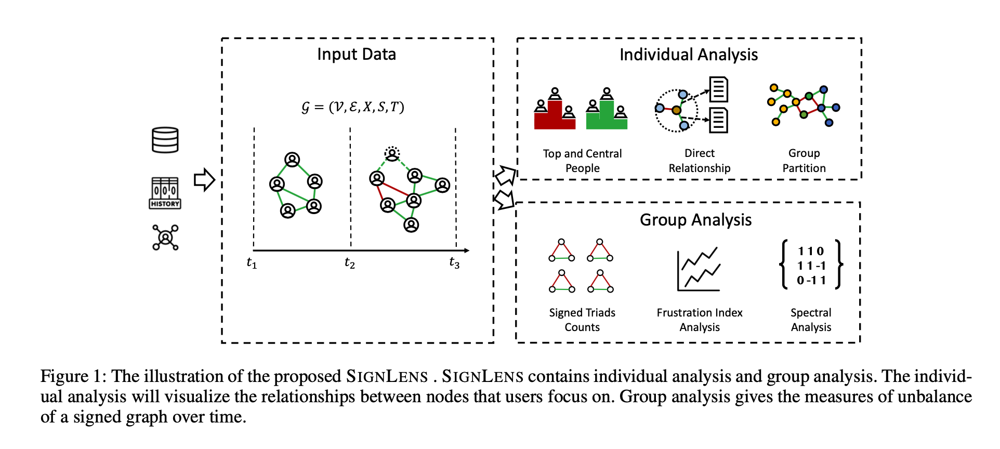

========
SIGNLENS
========

.. image:: https://github.com/huangjunjie-cs/SIGNLENS/actions/workflows/build.yml/badge.svg
        :target: https://github.com/huangjunjie-cs/SIGNLENS/actions

SIGNLENS measures and characterises **polarization** in signed social networks:
networks where relations are positive (cooperation, agreement, friendship) or
negative (opposition, disagreement, hostility).

It ships as

* a Python package, ``signlens`` (the 2021 ``sign_lens`` API still works),
* a command-line tool, ``signlens``,
* a FastAPI server and an interactive, bilingual (EN / 中文) web app.

What it measures
================

=============  ==============================================  ==========================================================
Axis           Question                                        Measures
=============  ==============================================  ==========================================================
Structure      How close is the network to two hostile camps?  triangle balance, frustration index (exact / heuristic),
                                                               algebraic conflict, walk-based balance
Camps          Who forms the opposing sides?                   balance partition, polarized communities & polarity
Separation     How sealed off are the camps?                   signed modularity, block contrast, E–I, random-walk
                                                               controversy
Positions      How far apart do people stand?                  spectral positions, vote-matrix ideal points, bimodality,
                                                               overlap, Esteban–Ray
Individuals    Who bridges or breaks ranks?                    bridging, dissent, frustrated ties per node
Time           When did the split happen?                      any of the above on sliding windows
=============  ==============================================  ==========================================================

The original descriptive metrics (sign distribution, signed triangles and
butterflies, degree distributions, hop plot, singular values) are kept.

Quick start
===========

.. code-block:: bash

    pip install -e ".[server]"
    signlens polarization edges.tsv            # source  target  sign [time]
    signlens -f edges.tsv                      # the 2021 descriptive report

.. code-block:: python

    import signlens as sl

    g = sl.SignedGraph.from_csv("edges.tsv")
    sl.polarization_profile(g)                 # every measure, JSON-ready
    fr = sl.frustration(g)                     # fr.frustration, fr.index, fr.partition
    sl.polarized_communities(g).polarity

Web app
-------

.. code-block:: bash

    (cd web && npm install && npm run build)
    signlens congress            # optional: Voteview data for every Congress, 1789–today (~15 min)
    signlens serve               # http://127.0.0.1:8000 — API docs at /api/docs

Data
====

* **U.S. Congress (updated)** — every House and Senate roll call since 1789
  from `Voteview <https://voteview.com>`_ (``signlens.datasets.load_congress``),
  replacing the GovTrack scraper. ``signlens congress`` builds per-Congress
  co-voting networks, ideal points (validated against DW-NOMINATE, r ≈ 0.97 in
  recent Congresses) and the polarization time series.
* **CBDB / USCV (2021 release)** — download from
  `Kaggle <https://www.kaggle.com/h12345jack/signlens>`_ and put the TSV files
  in ``datas/``; they are picked up automatically by the web app. See
  `datas/readme.md <./datas/readme.md>`_.
* **Synthetic** — ``signlens.synthetic`` generates polarized networks with known ground truth.

Project layout
==============

::

    signlens/          core library (graph, basic, balance, polarization, projection, temporal, datasets, congress)
    signlens/server/   FastAPI app
    sign_lens/         backward-compatible 2021 API
    web/               React + Tailwind front end
    tests/             pytest suite (metrics checked against brute force)
    docs/              Sphinx documentation
    spiders/, ipynbs/  2021 data collection scripts and notebooks

Cite
----

Please cite `our paper <https://ojs.aaai.org/index.php/ICWSM/article/view/18136>`_  if you use these codes and datasets in your own work:

.. code-block:: bash
 
    @inproceedings{huang2021signlens,
      title={SIGNLENS: A Tool for Analyzing People's Polarization Social Relationship Based on Signed Graph Modeling},
      author={Huang, Junjie and Shen, Huawei and Cheng, Xueqi},
      booktitle={Proceedings of the International AAAI Conference on Web and Social Media},
      volume={15},
      pages={1091--1093},
      year={2021}
    }

Feel free to `email us <mailto:huangjunjie17s@ict.ac.cn>`_ if you wish to improve this project

